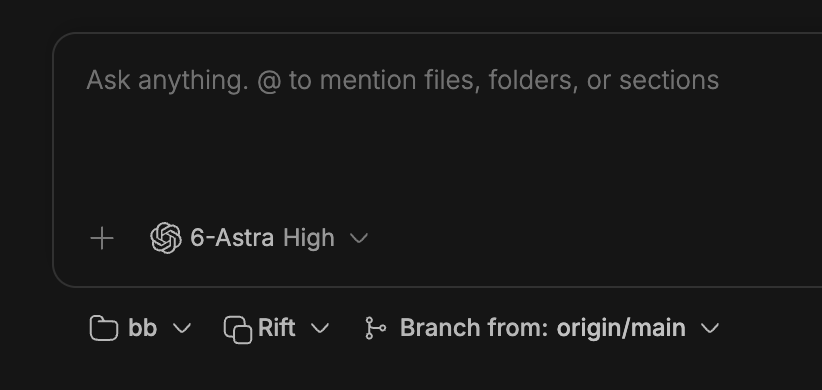

# Rift for BB

Give each BB thread its own copy of your project.

[Rift](https://github.com/anomalyco/rift) is a tool from [Anomaly](https://anoma.ly) (OpenCode creators) for making fast, space-efficient copies of a project.

This plugin brings Rift to [BB](https://getbb.app)'s environment picker and handles installing and updating it for you.



## Why use Rift over worktrees?

[Git worktrees](https://git-scm.com/docs/git-worktree) give each thread separate working files, but they start from what is tracked in Git. Installed dependencies, build caches, and ignored local configuration need to be prepared separately for each new worktree.

This plugin uses Rift to bring those files into each new environment. On macOS, APFS copy-on-write lets the copies initially share storage, allocating separate storage as files change. Each thread can reuse the setup already on disk and change its own copy independently.

Rift also copies the Git repository. Worktrees share local branches and commits; Rift environments can use the same branch name independently. New commits stay in that copy until you explicitly share them, for example by pushing and fetching.

## Install

With BB 0.43 or later installed, run:

```sh
bb plugin install https://github.com/aulneau/bb-plugin-rift
```

Choose **Rift** in the environment picker when creating a thread. Use **Branch from** beside it to choose a starting branch. The first launch prepares Rift on the machine containing your project, then runs your normal BB setup script.

Requires macOS with APFS, an original Git checkout, and an `origin` remote. Linked Git worktrees are unsupported.

## A fresh branch, with your dependencies in place

By default, the plugin fetches `origin/main` and starts the new branch at that commit. Choose another remote branch to fetch that branch instead, or a local branch to use its current commit, including unpushed work.

Your original checkout keeps its branch, index, and local edits. Copied tracked edits and non-ignored untracked files are cleared from the new environment. Installed dependencies and ignored caches remain; your setup script can bring them into line with the selected branch.

Existing environments retain their work when main advances.

## Adjust the defaults

Open **Settings → Rift** to choose the default starting branch, control fetching, or turn dependency reuse off. Projects can have their own creation settings.

Choose a machine to see its Rift version, check for updates, or update immediately. BB automatically checks used machines daily while running. An executable override lets you use a Rift installation you manage yourself.

For offline work, turn off fetching to use the last-fetched remote branch. A compatible Rift executable must already be available on that machine.

## Keep your work

Archiving a thread retains its environment. Explicit environment removal moves its snapshot into adjacent trash, preserving its files and Git history. The plugin never runs Rift garbage collection. BB teardown scripts run before removal.

A missing environment is not silently recreated. Restore its retained directory or start a new one.

## Reference

[Commands, settings and development](docs/reference.md) · [Operating guidance](skills/rift-environments/SKILL.md) · [Verification](VERIFICATION.md)

[MIT](LICENSE)
